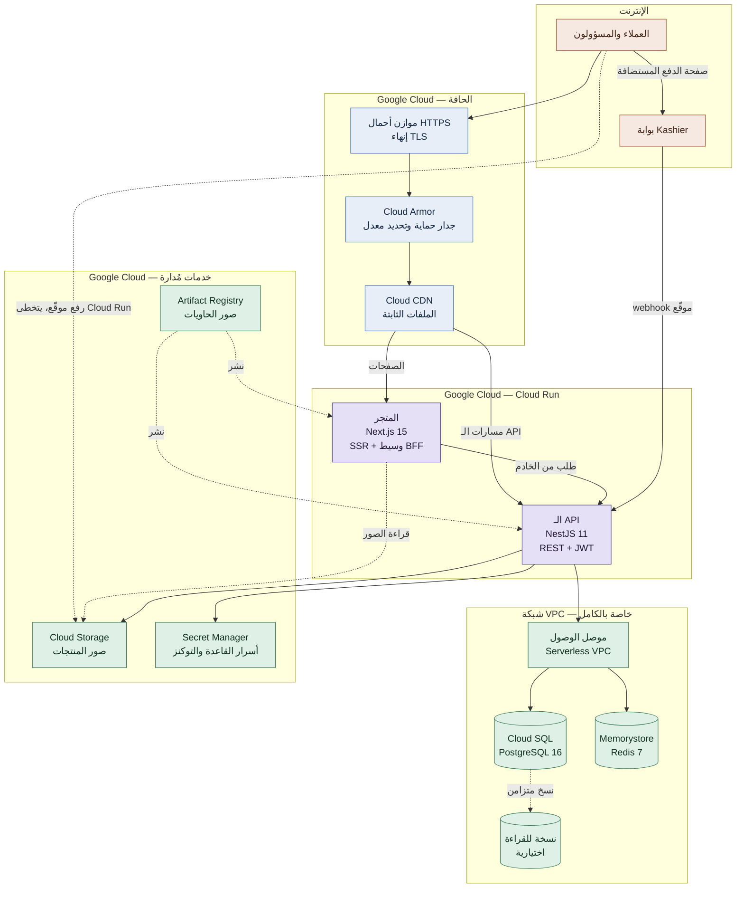
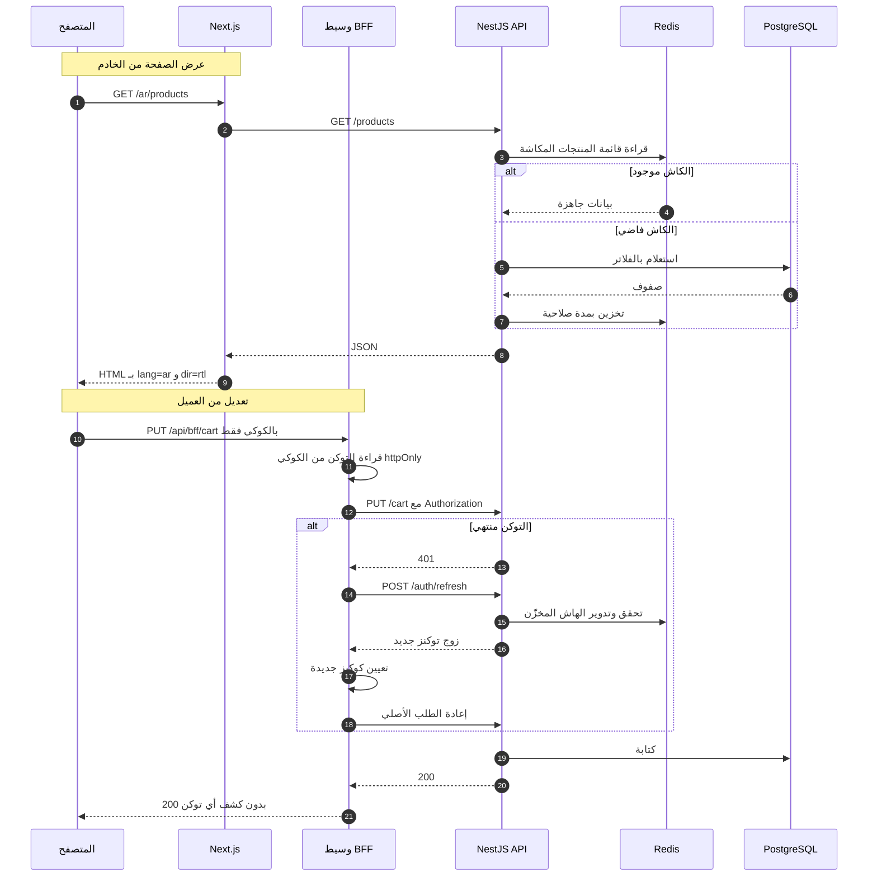
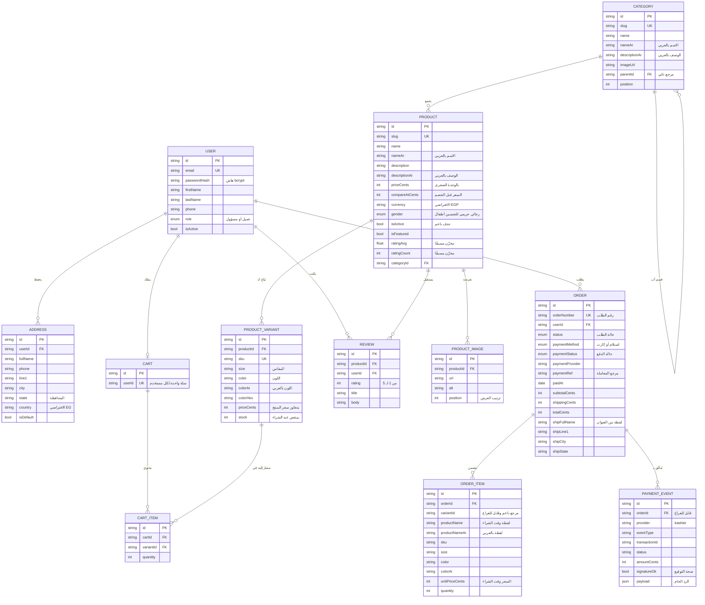
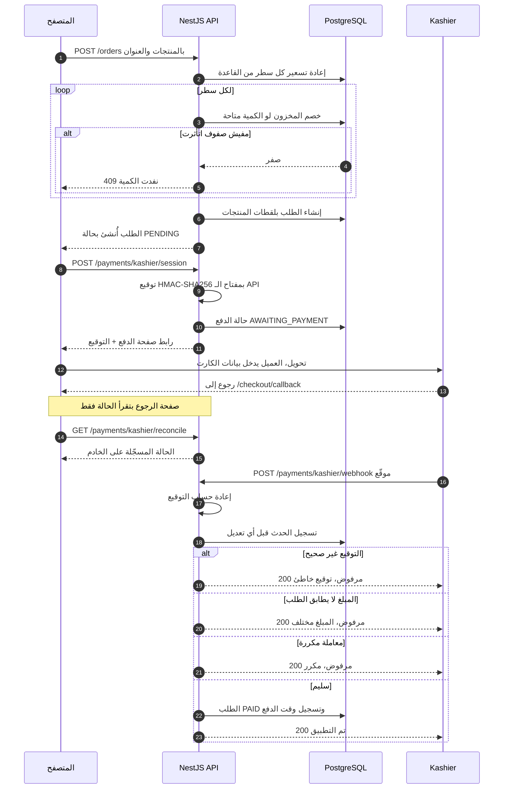
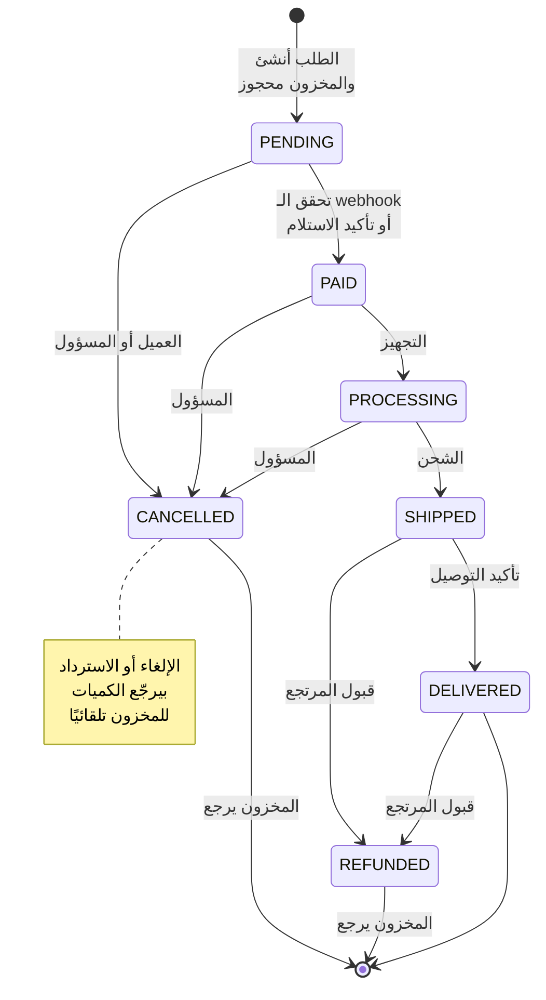
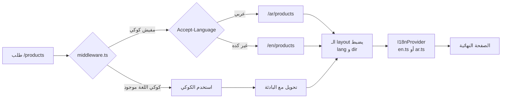
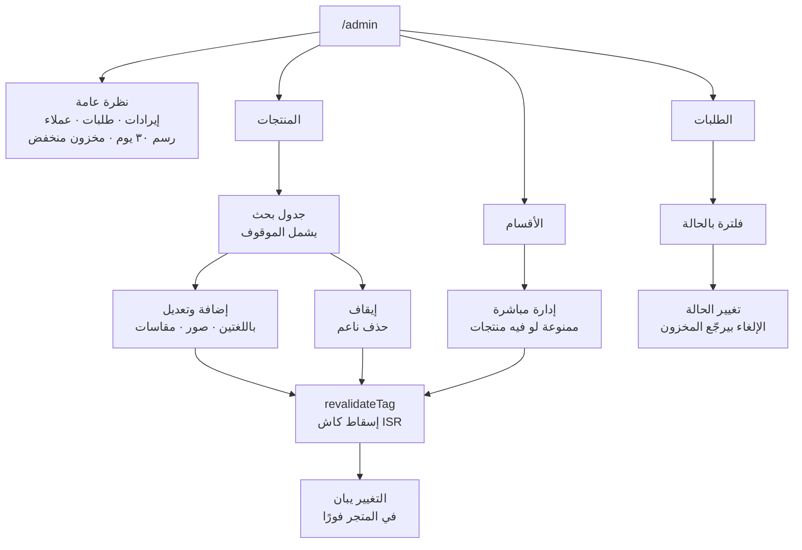
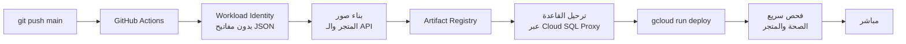

# أتيليه — متجر ملابس متكامل ثنائي اللغة

**[English](README.md)** · العربية

<div dir="rtl">

تطبيق تجارة إلكترونية بمعايير الإنتاج لعلامة ملابس، متصمّم ليشتغل على Google
Cloud Platform. ثنائي اللغة (عربي / إنجليزي بدعم RTL كامل)، بمظهر فاتح وداكن،
مع الدفع بالكارت عن طريق Kashier، ولوحة تحكم للمنتجات والأقسام والطلبات.

</div>

<table dir="rtl">
<tr><td><b>الواجهة</b></td><td>Next.js 15 (App Router) · Tailwind CSS 4 · Zustand · Zod · Sonner</td><td>Cloud Run</td></tr>
<tr><td><b>الـ API</b></td><td>NestJS 11 · Prisma 6 · Passport JWT</td><td>Cloud Run</td></tr>
<tr><td><b>قاعدة البيانات</b></td><td>PostgreSQL 16</td><td>Cloud SQL (IP خاص)</td></tr>
<tr><td><b>الكاش</b></td><td>Redis 7</td><td>Memorystore</td></tr>
<tr><td><b>الوسائط</b></td><td>رفع مباشر بروابط موقّعة V4</td><td>Cloud Storage</td></tr>
<tr><td><b>الدفع</b></td><td>صفحة Kashier المستضافة + webhook موقّع</td><td>—</td></tr>
<tr><td><b>الحافة</b></td><td>موازن أحمال HTTPS · CDN · جدار حماية</td><td>Cloud LB / CDN / Armor</td></tr>
</table>

<div dir="rtl">

## المحتويات

- [معمارية النظام](#معمارية-النظام)
- [دورة حياة الطلب](#دورة-حياة-الطلب)
- [تصميم قاعدة البيانات](#تصميم-قاعدة-البيانات)
- [الشراء والدفع](#الشراء-والدفع)
- [اللغات والمظهر](#اللغات-والمظهر)
- [لوحة التحكم](#لوحة-التحكم)
- [هيكل المشروع](#هيكل-المشروع)
- [التشغيل محليًا](#التشغيل-محليًا)
- [واجهة الـ API](#واجهة-الـ-api)
- [النشر على GCP](#النشر-على-gcp)
- [قرارات التصميم](#قرارات-التصميم)
- [التكلفة والتوسّع](#التكلفة-والتوسّع)
- [حدود المشروع الحالية](#حدود-المشروع-الحالية)

---

## معمارية النظام

الترافيك بيدخل من موازن أحمال HTTPS عالمي بينهي الـ TLS، بيفلتر بـ Cloud Armor،
وبيكاش الملفات الثابتة في Cloud CDN. الخدمتين serverless، وطبقة البيانات مالهاش
IP عام أصلًا — الطريق الوحيد ليها هو الـ VPC connector.

</div>



<div dir="rtl">

### ليه متصمّم كده

| القرار | السبب |
| --- | --- |
| خدمتين Cloud Run مش واحدة | المتجر بيتوسّع حسب عدد الزيارات، والـ API حسب عمليات الكتابة. الفصل بيخلي كل واحدة تتوسّع وتفشل لوحدها. |
| طبقة البيانات على IP خاص فقط | Cloud SQL و Memorystore مش قابلين للوصول من الإنترنت؛ المدخل الوحيد هو الـ VPC connector. |
| الرفع بيتخطى Cloud Run | الـ API بيصدر رابط موقّع والمتصفح بيكتب على الـ bucket مباشرة، فبايتات الصور عمرها ما بتستهلك وقت أو ذاكرة من الخدمة. |
| الـ CDN قدام المتجر بس | ردود الـ API إما خاصة بمستخدم أو متكاشة في Redis أصلًا؛ كاشها على الحافة معناه تسريب بيانات عميل لعميل تاني. |
| الأسرار من Secret Manager | ولا قيمة سرية بتتحط في طبقة صورة أو في تعريف خدمة. |

---

## دورة حياة الطلب

المتصفح عمره ما بيمسك JWT. التوكنز في كوكيز `httpOnly`، ومسار BFF على نفس الـ
origin هو اللي بيضيفها من ناحية الخادم — وده كمان معناه إن المتصفح ما بيعملش أي
طلب cross-origin، فمفيش سطح CORS يتظبط غلط من الأساس.

</div>



<div dir="rtl">

توكن التحديث بيتدوّر مع كل استخدام: التوكن المقدَّم بيتلغي في نفس اللحظة اللي
بيتولد فيها زوج جديد، والمخزَّن في Redis هو هاش SHA-256 بس. ولو اتقدّم توكن سبق
تدويره، كل جلسات المستخدم بتتلغي — وده الرد المعتاد على شبهة سرقة توكن.

---

## تصميم قاعدة البيانات

PostgreSQL 16 من خلال Prisma. الفلوس متخزّنة كأعداد صحيحة بالوحدة الصغرى
(`priceCents`) في كل مكان — مش أرقام عشرية — وبتتنسّق مرة واحدة عند العرض.

> أسماء الجداول والحقول في الرسم إنجليزية لأنها أعمدة حقيقية في القاعدة؛
> التعليقات جنبها عربية.

</div>



<div dir="rtl">

### قرارات النمذجة

| الاختيار | ليه |
| --- | --- |
| **الفلوس كأعداد صحيحة** | `290000` تساوي ٢٬٩٠٠٫٠٠ ج.م. الأرقام العشرية بتراكم خطأ تقريب على مدار السلة؛ الأعداد الصحيحة لأ. |
| **المخزون على المقاس مش المنتج** | المخزون خاصية لـ «مقاس M أسود»، مش للمنتج ككل. وده اللي بيخلي الخصم الشرطي لكل مقاس ممكن. |
| **سطور الطلب بتحفظ لقطة من كل حاجة** | `productName` و`productNameAr` و`sku` و`unitPriceCents` بتتنسخ وقت الشراء. تغيير اسم أو سعر بعدين ما يصحش يعيد كتابة فاتورة قديمة. |
| **`variantId` في سطر الطلب مرجع ناعم** | قابل للفراغ و**مش** مفتاح أجنبي، عشان حذف مقاس ما يتسلسلش على تاريخ الطلبات. |
| **الأعمدة العربية جنب الإنجليزية** | لغتين بالظبط، وكل صف عنده الاتنين. جدول ترجمات منفصل كان هيضيف join لكل قراءة من غير فايدة. |
| **الحذف الناعم بـ `isActive`** | إيقاف المنتج بيخفيه من المتجر بينما تاريخ الطلبات يفضل مربوط بصف حقيقي. |
| **`ratingAvg` و`ratingCount` مخزّنين مسبقًا** | من غيرهم كل صفحة كتالوج هتعمل تجميع على جدول التقييمات. بيتحسبوا عند كتابة تقييم. |
| **`PAYMENT_EVENT` للإضافة فقط** | كل رد من البوابة بيتسجّل قبل ما الطلب يتلمس، وده بيخلي السجل هو المرجع وقت أي نزاع على دفعة. |

### الفهارس المهمة

| الجدول | الفهرس | بيخدم |
| --- | --- | --- |
| `products` | `(isActive, createdAt)` | ترتيب الكتالوج الافتراضي |
| `products` | `slug` فريد | فتح صفحة المنتج |
| `product_variants` | `(productId, size, color)` فريد | منع تكرار المقاسات |
| `product_variants` | `sku` فريد | التحديث من اللوحة بالكود |
| `cart_items` | `(cartId, variantId)` فريد | سطر واحد لكل مقاس |
| `orders` | `(userId, createdAt)` | صفحة سجل الطلبات |
| `payment_events` | `(provider, transactionId, eventType)` فريد | **منع تكرار الـ webhook** |
| `reviews` | `(productId, userId)` فريد | تقييم واحد لكل عميل |

---

## الشراء والدفع

المخزون بيتحجز بـ `UPDATE` شرطي، فمستحيل عميلين ياخدوا آخر قطعة. والأسعار
بتتقرا من القاعدة عند الشراء — اللي بيبعته العميل طلب مش عرض سعر.

</div>



<div dir="rtl">

**الـ webhook هو الوحيد اللي بيكتب حالة `PAID`.** رجوع المتصفح مش موثوق — لو
العميل عدّل الرابط ما بيتغيرش أي حاجة. تلات فحوصات مستقلة بتحرس الانتقال:

1. **التوقيع** — إعادة حساب HMAC-SHA256 على الحقول اللي Kashier سمّتها في
   `signatureKeys`، والمقارنة بوقت ثابت.
2. **المبلغ** — رد موقّع صح بس مبلغه مش مطابق للطلب بيترفض، ما بيتطبقش.
3. **منع التكرار** — فهرس فريد على `(provider, transactionId, eventType)` بيخلي
   إعادة الإرسال بلا أثر.

منطق التوقيع عليه اختبارات وحدة (`npm test` جوه `backend/`) بتغطي التوقيع
المزوّر والمبلغ المعدّل وإعادة ترتيب الحقول، من غير ما تلمس البوابة.

### آلة حالات الطلب

</div>



<div dir="rtl">

العميل يقدر يلغي من `PENDING` أو `PAID` بس؛ أي انتقال بعد كده للمسؤول.

---

## اللغات والمظهر

كل صفحة موجودة تحت `/en` أو `/ar`.

</div>



<div dir="rtl">

الترجمات في ملفين. `src/i18n/messages/en.ts` هو المصدر، و`ar.ts` متبني عليه
بالأنواع، يعني **أي مفتاح عربي ناقص بيكسر الـ build** بدل ما يطلع إنجليزي في
صفحة عربية بالسكوت. التبديل بيستخدم علامات `{token}` — القاموس بيعدّي حدود
الخادم/العميل فلازم يفضل قابل للتحويل لـ JSON، وعشان كده مفيهوش دوال.

الـ RTL مش محتاج شغل في كل مكوّن: الـ layout بيضبط `dir`، والـ CSS بيستخدم خصائص
منطقية (`start`/`end` و`ms`/`me`) بدل يمين وشمال.

**المظهر** فاتح / داكن / حسب النظام. مفيش ولا كلاس `dark:` في المكوّنات — الكلاس
`.dark` بيعيد تعريف `--color-paper` و`--color-ink` وإخواتهم، وكل كلاسات Tailwind
بتقرا من المتغيرات دي. وفيه سكربت في `<head>` بيطبّق الاختيار المحفوظ قبل أول
رسم للصفحة، فمفيش وميض.

---

## لوحة التحكم

`/{locale}/admin`، متاحة لدور `ADMIN` فقط.

</div>



<div dir="rtl">

الفحص في الـ layout طبقة حماية إضافية — كل endpoint في اللوحة بيتحقق من الدور
بنفسه، فتخطي الواجهة ما بيفيدش بحاجة.

---

## هيكل المشروع

</div>

```
backend/                      واجهة NestJS البرمجية
  prisma/schema.prisma        نموذج البيانات
  prisma/seed.ts              كتالوج تجريبي بصور حقيقية من Unsplash
  src/common/                 Prisma و Redis و التخزين والحُرّاس والفلاتر
  src/modules/                auth, users, categories, products, cart, orders,
                              reviews, uploads, payments (Kashier), admin, health
frontend/                     متجر Next.js
  src/app/[locale]/           كل الصفحات، تحت /en أو /ar
  src/app/[locale]/admin/     اللوحة: نظرة عامة، منتجات، أقسام، طلبات
  src/app/api/                وسيط BFF، كوكيز الدخول، إبطال الكاش
  src/middleware.ts           تحديد اللغة والتحويل
  src/i18n/                   القواميس والمزوّد ورابط مدرك للغة
  src/components/             layout, product, cart, admin, payment, forms, UI
  src/lib/                    جلب من الخادم والعميل، الجلسة، الاستعلامات، البيئة
  src/schemas/                مخططات Zod مبنية من القاموس الحالي
  src/store/                  مخازن Zustand (السلة والمستخدم)
infra/terraform/              VPC، Cloud SQL، Memorystore، GCS، Cloud Run،
                              LB + CDN + Armor، الصلاحيات، Secret Manager
.github/workflows/            التكامل المستمر والنشر على Cloud Run
docker-compose.yml            بيئة محلية تحاكي طوبولوجيا GCP
```

<div dir="rtl">

---

## التشغيل محليًا

يحتاج Node 22+ و Docker.

</div>

```bash
make setup
```

<div dir="rtl">

وبعدين إما تشغّل كل حاجة في حاويات:

</div>

```bash
make up
```

<div dir="rtl">

…أو تشغّل قواعد البيانات في Docker والتطبيقات على الجهاز، وده أسرع في التطوير:

</div>

```bash
make infra                # postgres + redis
make migrate name=init
make seed
make dev-api              # http://localhost:8080/api/v1  (توثيق على /api/v1/docs)
make dev-web              # http://localhost:3000
```

<div dir="rtl">

حسابات البيانات التجريبية:

| الدور | البريد | كلمة المرور |
| --- | --- | --- |
| مسؤول | `admin@atelier.test` | `Admin123!` |
| عميل | `customer@atelier.test` | `Customer123!` |

### صور الكتالوج

البيانات التجريبية بتستخدم صور ملابس حقيقية من Unsplash، مشار ليها بمعرّف الصورة
في `backend/prisma/seed.ts`. المخزَّن هو المعرّف بس — القص والمقاس والصيغة كلها
معاملات في الرابط، فنفس الصورة بتخدم قصّة المنتج ٣:٤ ومربع القسم وبانر الصفحة
الرئيسية.

رخصة Unsplash بتسمح بالاستخدام التجاري من غير نسب، وعشان كده آمنة كبيانات
تجريبية. **ما تستبدلهاش بصور مأخوذة من موقع متجر تاني** — صور المنتجات محمية
بحقوق ملكية. للمخزون الحقيقي، ارفع من اللوحة؛ الصور دي بتروح Cloud Storage برابط
موقّع وبتتقدّم من الـ bucket بتاعك.

---

## واجهة الـ API

كل المسارات ببادئة `/api/v1`. توثيق Swagger على `/api/v1/docs` خارج بيئة الإنتاج.

| الطريقة | المسار | الوصول | الغرض |
| --- | --- | --- | --- |
| POST | `/auth/register` | عام | إنشاء حساب وإرجاع زوج توكنز |
| POST | `/auth/login` | عام | تسجيل الدخول |
| POST | `/auth/refresh` | عام | تدوير توكن التحديث |
| POST | `/auth/logout` | عام | إلغاء التوكن المقدَّم |
| GET | `/auth/me` | عميل | بيانات المستخدم الحالي |
| GET | `/products` | عام | بحث وفلترة وترتيب وتقسيم صفحات |
| GET | `/products/featured` | عام | مختارات الصفحة الرئيسية |
| GET | `/products/filters` | عام | المقاسات والألوان ونطاق السعر |
| GET | `/products/:slug` | عام | تفاصيل المنتج ومنتجات مشابهة |
| POST | `/products` | مسؤول | إنشاء منتج بصوره ومقاساته |
| PATCH | `/products/:id` | مسؤول | تعديل منتج |
| DELETE | `/products/:id` | مسؤول | إيقاف المنتج (حذف ناعم) |
| GET | `/categories` | عام | شجرة الأقسام مع عدد المنتجات |
| GET | `/cart` | عميل | السلة بأسعار ومخزون حيّ |
| PUT | `/cart` | عميل | استبدال محتوى السلة |
| POST | `/cart/merge` | عميل | دمج سلة الزائر بعد الدخول |
| POST | `/orders` | عميل | إتمام الشراء |
| GET | `/orders` | عميل | سجل الطلبات |
| PATCH | `/orders/:id/cancel` | عميل | إلغاء الطلب وإرجاع المخزون |
| PATCH | `/orders/:id/status` | مسؤول | تحريك الطلب في مراحل التجهيز |
| GET | `/products/:slug/reviews` | عام | تقييمات المنتج |
| POST | `/products/:slug/reviews` | عميل | تقييم منتج تم شحنه |
| GET | `/payments/methods` | عام | طرق الدفع المتاحة في البيئة |
| POST | `/payments/kashier/session/:id` | عميل | إنشاء جلسة دفع مستضافة |
| POST | `/payments/kashier/webhook` | عام | رد البوابة الموقّع، الكاتب الوحيد لـ PAID |
| GET | `/payments/kashier/reconcile` | عميل | قراءة حالة الطلب بعد الرجوع |
| POST | `/uploads/signed-url` | مسؤول | إصدار رابط رفع موقّع لـ GCS |
| GET | `/admin/stats` | مسؤول | الإيرادات والرسم والمخزون والأكثر مبيعًا |
| GET | `/admin/products` | مسؤول | الكتالوج شاملًا الموقوف |
| GET | `/health`, `/health/ready` | عام | فحوصات Cloud Run |

---

## النشر على GCP

</div>



<div dir="rtl">

### ١. تجهيز البنية

</div>

```bash
cd infra/terraform
cp terraform.tfvars.example terraform.tfvars   # اضبط project_id على الأقل
terraform init
terraform apply
```

<div dir="rtl">

أول تنفيذ بينشر الخدمتين بصورة مؤقتة عشان الروابط تتولد. بعد كده Terraform
بيتجاهل تغييرات الصور — الـ CI هو اللي بيملك النسخة الشغالة.

### ٢. أول ترحيل للقاعدة

Cloud SQL مالهاش IP عام، فالاتصال بيكون عن طريق Cloud SQL Auth Proxy:

</div>

```bash
cloud-sql-proxy --port 5432 "$(terraform -chdir=infra/terraform output -raw database_instance)" &

cd backend
DATABASE_URL="postgresql://atelier_app:$(terraform -chdir=../infra/terraform output -raw database_password)@127.0.0.1:5432/atelier?schema=public" \
  npx prisma migrate deploy
```

<div dir="rtl">

### ٣. أسرار الـ CI/CD

اربط Workload Identity pool بحساب الخدمة `*-deployer`، وبعدين اضبط:

| السر | القيمة |
| --- | --- |
| `WIF_PROVIDER` | الاسم الكامل للمزوّد |
| `DEPLOYER_SA` | `terraform output deployer_service_account` |
| `GCP_PROJECT_ID` | معرّف المشروع |
| `CLOUDSQL_CONNECTION_NAME` | `terraform output database_instance` |
| `MIGRATION_DATABASE_URL` | رابط الاتصال عبر البروكسي للترحيل |
| `SITE_URL` | رابط المتجر العام |
| `GCS_BUCKET` | `terraform output media_bucket` |

### ٤. إعداد Kashier

</div>

```bash
KASHIER_MERCHANT_ID=MID-xxxx
KASHIER_API_KEY=...
KASHIER_SECRET_KEY=...      # فقط لو Kashier أصدرت مفتاح سري منفصل
KASHIER_MODE=test           # أو live
STOREFRONT_URL=https://shop.example.com
API_PUBLIC_URL=https://api.example.com/api/v1
```

<div dir="rtl">

سيب `KASHIER_MERCHANT_ID` فاضي والدفع بالكارت هيختفي من صفحة الشراء — المتجر
ساعتها بيعرض الدفع عند الاستلام بس.

### ٥. تفعيل الحافة

اضبط `custom_domain` و`enable_load_balancer = true`، نفّذ، ووجّه سجل `A` على
`terraform output load_balancer_ip`. ولما الشهادة المُدارة تبقى `ACTIVE`، اضبط
`lb_only_ingress = true` ونفّذ تاني — ده بيقفل روابط `run.app` فيبقى كل الترافيك
مجبر يعدي على Cloud Armor.

---

## قرارات التصميم

- **المتصفح عمره ما بيمسك JWT.** التوكنز في كوكيز `httpOnly`، والوسيط بيضيفها من
  ناحية الخادم وبيدوّرها تلقائيًا عند 401. مفيش CORS ومفيش توكن في `localStorage`.
- **الأسعار والمخزون ما بيتاخدوش من العميل.** الشراء بيعيد التسعير من القاعدة
  وبيحجز المخزون بـ `UPDATE` شرطي.
- **حالة الدفع ليها كاتب واحد بس** — الـ webhook المتحقَّق من توقيعه.
- **Redis اختياري وقت التشغيل.** كل قراءة من الكاش بتتراجع لاستعلام من القاعدة؛
  توقف Memorystore بيبطّئ الموقع بس ما بيوقعهوش.
- **كل متغيرات البيئة بتعدّي على `src/lib/env.ts`.** الـ `ARG` الفاضي في Docker
  بيبقى نص فاضي، و`process.env.X ?? default` بيحتفظ بيه — وده بيكسر `new URL('')`
  وبيخلي `Number('')` تساوي صفر.

تفصيلتين شكلهم بسيط بس مش كده:

- `loading.tsx` موجود في `app/[locale]/products/(list)/` مش في جذر التطبيق. حدود
  التحميل بتخلي Next.js يبدأ البث فورًا، وده بيثبّت حالة HTTP قبل ما الصفحة
  تترسم — في الجذر كان بيحوّل كل `notFound()` لـ 200 وكل `redirect()` لحاجة غير
  307.
- `tsBuildInfoFile` بيشاور جوه `dist/`. أمر `nest build` بيمسح `dist/`، فكاش
  البناء اللي بره بيخلي `tsc` يقول «صفر أخطاء» من غير ما ينتج ملفات، والنتيجة
  صورة Docker من غير `dist/main.js`.

---

## التكلفة والتوسّع

- `backend_min_instances = 1` بيخلي نسخة API دافية دايمًا، وبيشيل تأخير البداية
  الباردة (~٢ ثانية) من أول عملية شراء في اليوم. خليها `0` في بيئة العرض.
- كل نسخة Cloud Run بتفتح مجموعة اتصالات خاصة بيها بالقاعدة. خلي حاصل ضرب
  `backend_max_instances` في حجم المجموعة أقل من `max_connections` (حاليًا ٢٠٠)؛
  ارفع فئة الخادم قبل ما ترفع السقف.
- `db-g1-small` و Memorystore بحجم ١ جيجا فئة `BASIC` مقاسات تجريبية. للترافيك
  الحقيقي انتقل لـ `db-custom-2-7680` وإتاحة `REGIONAL` و Redis فئة `STANDARD_HA`.
- تحديد المعدل جوه NestJS لكل نسخة على حدة، يعني حارس اندفاع مش حصة حقيقية.
  Cloud Armor هو الحصة الفعلية.
- الـ layout الجذري بيقرا كوكي الجلسة، فكل مسار HTML بيترسم عند الطلب. وعشان كده
  Cloud CDN بيكاش `/_next/static/*` مش الصفحات، والكتالوج بيتحمي من القاعدة
  بطبقتين تانيين: كاش بيانات Next.js (`revalidate: 60`) و Redis جوه الـ API.

---

## حدود المشروع الحالية

حدود مقصودة، مش سهو:

- **رسائل البريد** (تأكيد الطلب) مش منفّذة.
- **الاسترداد** انتقال حالة بيرجّع المخزون؛ مفيش إرجاع فلوس تلقائي عبر Kashier.
- **قوائم الأمنيات وأكواد الخصم وتعدد العملات** مش منمذجين.
- **بحث المنتجات** بـ `ILIKE` على الاسم والوصف. بعد بضعة آلاف منتج ده هيحتاج بحث
  نصي كامل في PostgreSQL أو فهرس مخصص.

</div>
