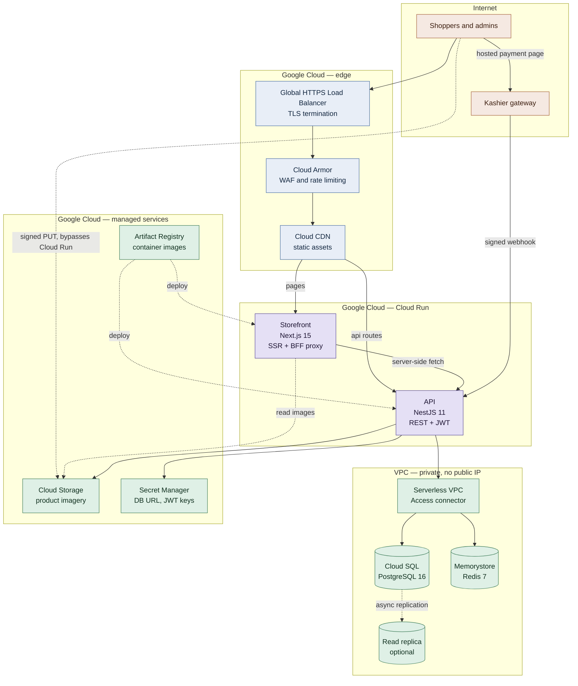
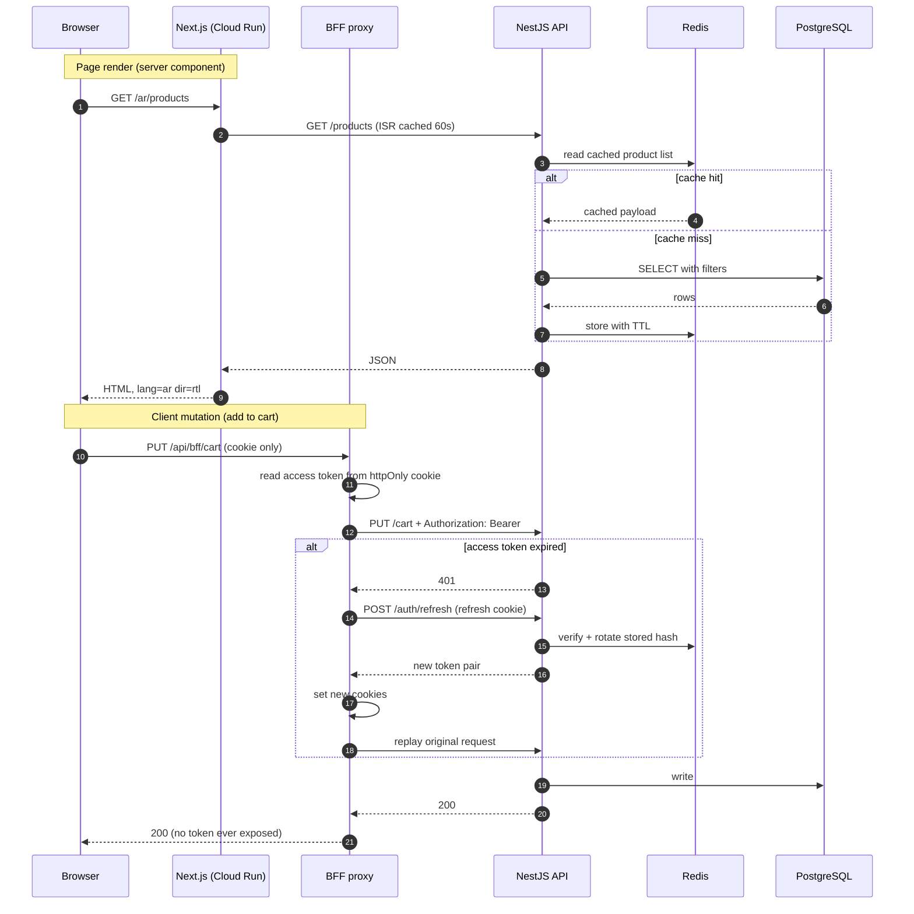
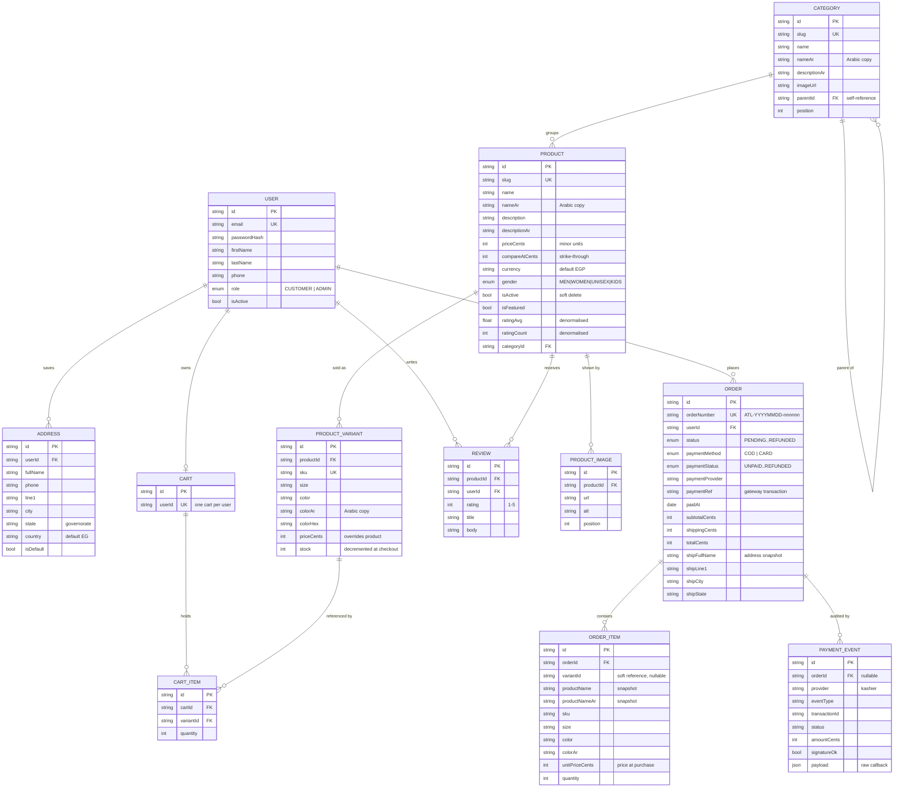
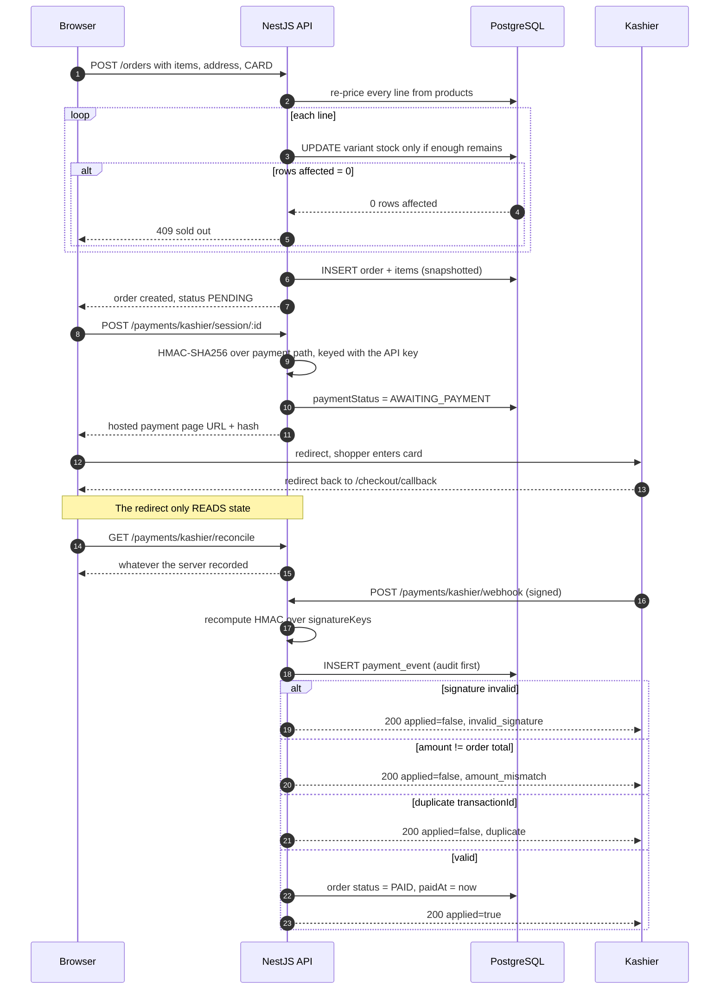
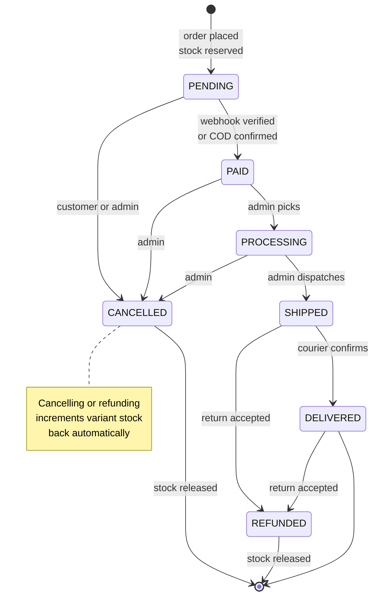
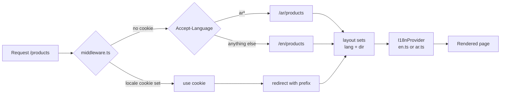
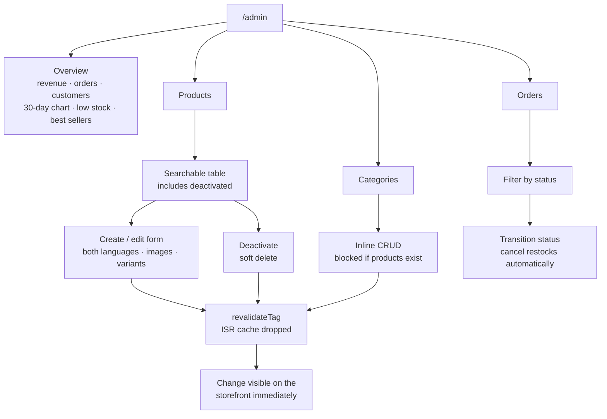
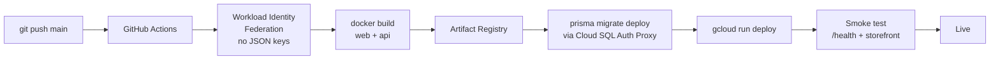

# Atelier — Full-Stack Bilingual Clothing Store

A production-shaped e-commerce application for a clothing brand, built to run on
Google Cloud Platform. Bilingual (English / Arabic with full RTL), themed
(light / dark / follow-OS), with card payments through Kashier and an admin
dashboard for products, categories and orders.

<table>
<tr><td><b>Storefront</b></td><td>Next.js 15 (App Router) · Tailwind CSS 4 · Zustand · Zod · Sonner</td><td>Cloud Run</td></tr>
<tr><td><b>API</b></td><td>NestJS 11 · Prisma 6 · Passport JWT</td><td>Cloud Run</td></tr>
<tr><td><b>Database</b></td><td>PostgreSQL 16</td><td>Cloud SQL (private IP)</td></tr>
<tr><td><b>Cache</b></td><td>Redis 7</td><td>Memorystore</td></tr>
<tr><td><b>Media</b></td><td>V4 signed uploads</td><td>Cloud Storage</td></tr>
<tr><td><b>Payments</b></td><td>Kashier hosted page + signed webhook</td><td>—</td></tr>
<tr><td><b>Edge</b></td><td>HTTPS load balancer · CDN · WAF</td><td>Cloud LB / CDN / Armor</td></tr>
</table>

## Contents

- [System architecture](#system-architecture)
- [Request lifecycle](#request-lifecycle)
- [Database design](#database-design)
- [Checkout and payments](#checkout-and-payments)
- [Languages and theming](#languages-and-theming)
- [Admin dashboard](#admin-dashboard)
- [Repository layout](#repository-layout)
- [Running locally](#running-locally)
- [API surface](#api-surface)
- [Deploying to GCP](#deploying-to-gcp)
- [Design decisions](#design-decisions)
- [Cost and scaling](#cost-and-scaling)
- [Known gaps](#known-gaps)

---

## System architecture

Traffic enters through a global HTTPS load balancer that terminates TLS, filters
with Cloud Armor and caches static assets in Cloud CDN. Both services are
serverless; the data tier has no public IP and is reachable only through a
Serverless VPC Access connector.



### Why it is shaped this way

| Decision | Reason |
| --- | --- |
| Two Cloud Run services, not one | The storefront scales on page views, the API on write throughput. Separate services scale and fail independently. |
| Data tier on private IP only | Cloud SQL and Memorystore are unreachable from the internet; the only path in is the VPC connector. |
| Uploads bypass Cloud Run | The API mints a V4 signed URL and the browser writes straight to the bucket, so image bytes never consume request time or memory. |
| CDN in front of the storefront only | API responses are user-specific or already cached in Redis; caching them at the edge would leak one shopper's data to another. |
| Secrets from Secret Manager | No secret value is ever baked into an image layer or a service definition. |

---

## Request lifecycle

The browser never holds a JWT. Tokens live in `httpOnly` cookies, and a
same-origin BFF route attaches them server-side — which also means the browser
makes zero cross-origin requests, so there is no CORS surface to misconfigure.



Refresh tokens rotate on every use: the presented token is invalidated the moment
a new pair is minted, and only a SHA-256 hash is stored in Redis. If a token that
was already rotated is replayed, every session for that user is dropped — the
standard response to a suspected stolen token.

---

## Database design

PostgreSQL 16 via Prisma. Money is stored as **integer minor units**
(`priceCents`) everywhere — never floats — and formatted once, at render.



### Modelling decisions

| Choice | Why |
| --- | --- |
| **Money as `Int` minor units** | `290000` = EGP 2,900.00. Floats accumulate rounding error across a cart; integers cannot. |
| **Variants own the stock, not products** | Stock is a property of "size M in black", not of the product. This is what makes a per-variant conditional decrement possible. |
| **Order items snapshot everything** | `productName`, `productNameAr`, `sku`, `unitPriceCents` are copied at purchase. A later rename or price change must never rewrite an existing invoice. |
| **`variantId` on `ORDER_ITEM` is a soft reference** | Nullable and *not* a foreign key, so deleting a variant cannot cascade into order history. |
| **Arabic columns beside English ones** | Exactly two locales, and every row has both. A separate translations table would add a join to every read for no benefit. |
| **Soft delete via `isActive`** | Deactivating a product hides it from the storefront while order history keeps pointing at a real row. |
| **Denormalised `ratingAvg` / `ratingCount`** | Product listings would otherwise aggregate the reviews table on every page of the catalogue. Recomputed on review write. |
| **`PAYMENT_EVENT` is append-only** | Every gateway callback is recorded before the order is touched, which makes the log the source of truth during a payment dispute. |

### Indexes that matter

| Table | Index | Serves |
| --- | --- | --- |
| `products` | `(isActive, createdAt)` | Default catalogue sort |
| `products` | `slug` unique | Product detail lookup |
| `product_variants` | `(productId, size, color)` unique | Prevents duplicate variants |
| `product_variants` | `sku` unique | Admin upsert by SKU |
| `cart_items` | `(cartId, variantId)` unique | One line per variant |
| `orders` | `(userId, createdAt)` | Order history page |
| `payment_events` | `(provider, transactionId, eventType)` unique | **Webhook idempotency** |
| `reviews` | `(productId, userId)` unique | One review per customer |

---

## Checkout and payments

Stock is claimed with a conditional `UPDATE`, so two shoppers cannot both buy the
last unit. Prices are re-read from the database at checkout — what the client
sends is a request, not a quote.



**The webhook is the only writer of `PAID`.** The browser redirect is never
trusted — a shopper editing the callback URL changes nothing. Three independent
checks guard the transition:

1. **Signature** — HMAC-SHA256 recomputed over the fields Kashier names in
   `signatureKeys`, compared in constant time.
2. **Amount** — a correctly signed callback whose amount does not match the order
   is refused, not applied.
3. **Idempotency** — a unique index on `(provider, transactionId, eventType)`
   makes a replayed delivery a no-op.

The signature logic is unit-tested (`npm test` in `backend/`) against forged
signatures, edited amounts and reordered keys, without touching the gateway.

### Order state machine



Customers may cancel only from `PENDING` or `PAID`; everything after that is an
admin transition.

---

## Languages and theming

Every page lives under `/en` or `/ar`.



Translations live in two files. `src/i18n/messages/en.ts` is the source and
`ar.ts` is typed against it, so **a missing Arabic key fails the build** rather
than silently rendering English. Interpolation uses `{token}` placeholders — the
dictionary crosses the server/client boundary and must stay JSON-serialisable, so
it contains no functions.

RTL needs no per-component work: the layout sets `dir`, and the CSS uses logical
properties (`start`/`end`, `ms`/`me`) instead of left/right.

**Theme** is light / dark / follow-OS. There is not one `dark:` utility in the
components — `.dark` redefines `--color-paper`, `--color-ink` and friends, and
every Tailwind class resolves through those variables. An inline script in
`<head>` applies the saved choice before first paint, so there is no flash.

---

## Admin dashboard

`/{locale}/admin`, restricted to the `ADMIN` role.



The layout check is defence in depth — every admin endpoint independently
enforces the role, so bypassing the UI gains nothing.

---

## Repository layout

```
backend/                      NestJS API
  prisma/schema.prisma        Data model
  prisma/seed.ts              Demo catalogue, real Unsplash photography
  src/common/                 Prisma, Redis, Storage, guards, filters, DTOs
  src/modules/                auth, users, categories, products, cart, orders,
                              reviews, uploads, payments (Kashier), admin, health
frontend/                     Next.js storefront
  src/app/[locale]/           Every page, under /en or /ar
  src/app/[locale]/admin/     Dashboard: overview, products, categories, orders
  src/app/api/                BFF proxy, auth cookies, cache revalidation
  src/middleware.ts           Locale detection and redirect
  src/i18n/                   Dictionaries, provider, locale-aware Link
  src/components/             layout, product, cart, admin, payment, forms, UI
  src/lib/                    server fetch, client fetch, session, queries, env
  src/schemas/                Zod schemas, built from the active dictionary
  src/store/                  Zustand stores (cart, auth)
infra/terraform/              VPC, Cloud SQL, Memorystore, GCS, Cloud Run,
                              LB + CDN + Armor, IAM, Secret Manager
.github/workflows/            CI and Cloud Run deployment
docker-compose.yml            Local stack mirroring the GCP topology
```

---

## Running locally

Requires Node 22+ and Docker.

```bash
make setup
```

Then either run everything in containers:

```bash
make up
```

…or run the data services in Docker and the apps on the host, which is a faster
feedback loop:

```bash
make infra                # postgres + redis
make migrate name=init
make seed
make dev-api              # http://localhost:8080/api/v1  (Swagger at /api/v1/docs)
make dev-web              # http://localhost:3000
```

Seeded accounts:

| Role | Email | Password |
| --- | --- | --- |
| Admin | `admin@atelier.test` | `Admin123!` |
| Customer | `customer@atelier.test` | `Customer123!` |

### Catalogue imagery

The seed uses real garment photography from Unsplash, referenced by photo id in
`backend/prisma/seed.ts`. Only the id is stored — crop, size and format are query
parameters, so one source photo serves the 3:4 product shot, the square category
tile and the wide hero.

The Unsplash License permits commercial use without attribution, which is why
these are safe to ship as demo data. **Do not replace them with images taken from
a retailer's website** — product photography is copyrighted. For real inventory,
upload through the admin; those land in Cloud Storage via a signed URL and are
served from your own bucket.

---

## API surface

All routes are prefixed with `/api/v1`. Swagger UI is served at `/api/v1/docs`
outside production.

| Method | Path | Access | Purpose |
| --- | --- | --- | --- |
| POST | `/auth/register` | public | Create an account, returns a token pair |
| POST | `/auth/login` | public | Exchange credentials for a token pair |
| POST | `/auth/refresh` | public | Rotate a refresh token |
| POST | `/auth/logout` | public | Revoke the presented refresh token |
| GET | `/auth/me` | customer | Current profile |
| GET | `/products` | public | Search, filter, sort, paginate |
| GET | `/products/featured` | public | Homepage edit |
| GET | `/products/filters` | public | Sizes, colours, price range for facets |
| GET | `/products/:slug` | public | Detail with variants and related items |
| POST | `/products` | admin | Create with images and variants |
| PATCH | `/products/:id` | admin | Update |
| DELETE | `/products/:id` | admin | Deactivate (soft delete) |
| GET | `/categories` | public | Category tree with product counts |
| GET | `/cart` | customer | Server cart with live prices and stock |
| PUT | `/cart` | customer | Replace cart contents |
| POST | `/cart/merge` | customer | Merge a guest cart on sign-in |
| POST | `/orders` | customer | Checkout |
| GET | `/orders` | customer | Order history |
| PATCH | `/orders/:id/cancel` | customer | Cancel and restock |
| PATCH | `/orders/:id/status` | admin | Move through fulfilment |
| GET | `/products/:slug/reviews` | public | Reviews |
| POST | `/products/:slug/reviews` | customer | Review a shipped purchase |
| GET | `/payments/methods` | public | Which methods this environment offers |
| POST | `/payments/kashier/session/:id` | customer | Create a hosted-page session |
| POST | `/payments/kashier/webhook` | public | Signed callback, sole writer of PAID |
| GET | `/payments/kashier/reconcile` | customer | Read order state after redirect |
| POST | `/uploads/signed-url` | admin | Mint a V4 signed PUT URL for GCS |
| GET | `/admin/stats` | admin | Revenue, chart, low stock, best sellers |
| GET | `/admin/products` | admin | Catalogue listing including inactive |
| GET | `/health`, `/health/ready` | public | Cloud Run probes |

---

## Deploying to GCP



### 1. Provision

```bash
cd infra/terraform
cp terraform.tfvars.example terraform.tfvars   # set project_id at minimum
terraform init
terraform apply
```

The first apply deploys both Cloud Run services with a placeholder image so the
service URLs exist. Terraform then ignores image changes — CI owns the running
revision from that point on.

### 2. First migration

Cloud SQL has no public IP, so connect through the Cloud SQL Auth Proxy:

```bash
cloud-sql-proxy --port 5432 "$(terraform -chdir=infra/terraform output -raw database_instance)" &

cd backend
DATABASE_URL="postgresql://atelier_app:$(terraform -chdir=../infra/terraform output -raw database_password)@127.0.0.1:5432/atelier?schema=public" \
  npx prisma migrate deploy
```

### 3. CI/CD secrets

Bind a Workload Identity pool to the `*-deployer` service account, then set:

| Secret | Value |
| --- | --- |
| `WIF_PROVIDER` | Full provider resource name |
| `DEPLOYER_SA` | `terraform output deployer_service_account` |
| `GCP_PROJECT_ID` | Project id |
| `CLOUDSQL_CONNECTION_NAME` | `terraform output database_instance` |
| `MIGRATION_DATABASE_URL` | Proxy connection string for migrations |
| `SITE_URL` | Public storefront URL |
| `GCS_BUCKET` | `terraform output media_bucket` |

### 4. Kashier

```bash
KASHIER_MERCHANT_ID=MID-xxxx
KASHIER_API_KEY=...
KASHIER_SECRET_KEY=...      # only if Kashier issued a separate secret key
KASHIER_MODE=test           # or live
STOREFRONT_URL=https://shop.example.com
API_PUBLIC_URL=https://api.example.com/api/v1
```

Leave `KASHIER_MERCHANT_ID` empty and card payment disappears from checkout —
the storefront then offers cash on delivery only.

### 5. Turn on the edge

Set `custom_domain` and `enable_load_balancer = true`, apply, and point an `A`
record at `terraform output load_balancer_ip`. Once the managed certificate is
`ACTIVE`, set `lb_only_ingress = true` and apply again — this closes the
`run.app` URLs so all traffic must pass through Cloud Armor.

---

## Design decisions

- **The browser never holds a JWT.** Tokens live in `httpOnly` cookies; the BFF
  attaches them server-side and silently rotates on 401. No CORS, no token in
  `localStorage`.
- **Prices and stock are never trusted from the client.** Checkout re-prices from
  the database and claims stock with a conditional `UPDATE`.
- **Payment state has exactly one writer** — the HMAC-verified webhook.
- **Redis is optional at runtime.** Every cache read degrades to a database
  query; a Memorystore outage slows the site but does not take it down.
- **Every environment variable goes through `src/lib/env.ts`.** A Docker `ARG`
  with no value becomes an empty string, and `process.env.X ?? default` keeps it
   — which breaks `new URL('')` and turns `Number('')` into `0`.

Two details that look trivial but are not:

- `loading.tsx` lives in `app/[locale]/products/(list)/`, not at the app root. A
  loading boundary makes Next.js stream immediately, which commits the HTTP
  status before the page renders — at the root it turned every `notFound()` into
  a soft 200 and every auth `redirect()` into a non-307.
- `tsBuildInfoFile` points inside `dist/`. `nest build` clears `dist/`, so an
  incremental cache left outside it makes `tsc` report "Found 0 errors", emit
  nothing, and produce an image with no `dist/main.js`.

---

## Cost and scaling

- `backend_min_instances = 1` keeps one warm API instance, removing a ~2 second
  cold start from the first checkout of the day. Set it to `0` for a demo.
- Each Cloud Run instance opens its own PostgreSQL pool. Keep
  `backend_max_instances × pool size` below the instance `max_connections`
  (currently 200); raise the tier before raising the ceiling.
- `db-g1-small` and a 1 GB `BASIC` Memorystore are pilot sizing. For real traffic
  move to `db-custom-2-7680`, `REGIONAL` availability and `STANDARD_HA` Redis.
- Rate limiting inside NestJS is per-instance, so it is a burst guard only. Cloud
  Armor is the real quota.
- The root layout reads the session cookie, so every HTML route renders on
  demand. Cloud CDN therefore caches `/_next/static/*` rather than pages, and the
  catalogue is kept off the database by two other layers: the Next.js data cache
  (`revalidate: 60`) and Redis inside the API.

---

## Known gaps

Deliberate scope boundaries, not oversights:

- **Transactional email** (order confirmation) is not implemented.
- **Refunds** are a status transition that restocks; no money is sent back
  through Kashier automatically.
- **Wishlists, discount codes and multi-currency** are not modelled.
- **Product search** is `ILIKE` against name and description. Past a few thousand
  products this wants PostgreSQL full-text search or a dedicated index.
